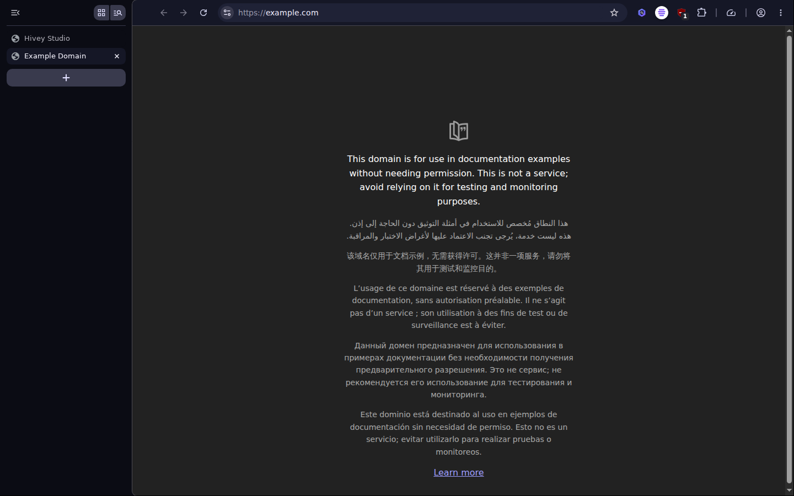

<p align="center"></p>

# Hivey Browser

A modern, deeply customizable, **privacy-first** web browser for Windows and
Linux, built on [ungoogled-chromium](https://github.com/ungoogled-software/ungoogled-chromium).

- **Private by construction.** No Google services, no telemetry, no crash or
  usage reporting, no field trials, no request at startup (checked in CI).
- **Blocks more than ads.** uBlock Origin Lite is built in: ads, trackers,
  cookie banners, tracking parameters in links, malware sites, with cosmetic
  filtering and a blocked-requests counter.
- **Locked down.** Sites cannot ask for USB, serial, HID or Bluetooth
  devices; an optional hardened mode turns the JavaScript JIT off.
- **Hard to fingerprint.** Noise in canvas, text metrics, element boxes and
  audio; GPU model hidden; processor count capped; only standard fonts
  visible; cross-site referrers cut to the origin; no Topics or Attribution
  Reporting.
- **Yours to shape.** Hivey Studio (`chrome://hivey`) puts everything in one
  place: themes and a color for every part of the browser (with an eyedropper
  that works anywhere on the screen), vertical tabs, compact mode, side
  panel position, toolbar buttons, a custom new tab page, tab behaviour.
- **AI that is not a security hole.** The Hivey AI sidebar is built in, with
  your own key or a local model; it reads a page only when you invoke it
  there, so pages cannot steer it (prompt injection).
- **Security tools at hand.** WHOIS, geolocation, DNS, certificates,
  VirusTotal, urlscan, Shodan and more from the toolbar or a right-click.
- **Light on your machine.** Like a gaming browser: RAM, CPU and network
  limiters, live usage gauges and a list of the hungriest tabs.
- **Always patched.** New Chromium releases are picked up, built, tested and
  published automatically; installed browsers update themselves from signed
  releases.



## Platforms

Windows x64 and Linux x64. The Windows build is **cross-compiled from
Linux**, so anyone can reproduce both without a Windows machine.

## Download

- **Latest release**: [releases/latest](https://github.com/FlorianMartins/hivey-browser/releases/latest)
  (Windows installer, Linux archive). Installed browsers update themselves.
- **Dev build** of main, for testing:
  [Windows](https://github.com/FlorianMartins/hivey-browser/releases/download/dev/hivey-browser-dev-windows-x64-installer.exe),
  [Linux](https://github.com/FlorianMartins/hivey-browser/releases/download/dev/hivey-browser-dev-linux-x64.tar.xz).
- What changed: [CHANGELOG.md](CHANGELOG.md).

The Windows installer is not code-signed yet: SmartScreen asks for
confirmation (*More info > Run anyway*).

## Building

```bash
git clone --recurse-submodules https://github.com/FlorianMartins/hivey-browser
cd hivey-browser
XWIN_ACCEPT_LICENSE=1 python3 scripts/hb.py all                    # Windows
HB_TARGET=linux python3 scripts/hb.py configure build package      # then Linux, same tree
```

You need about 150 GB of disk, 32 GB of RAM and several hours for the first
build. See [docs/BUILDING.md](docs/BUILDING.md) for prerequisites, every step,
and how to keep the build from disturbing other services on the same machine.

## How it is made

Hivey Browser is a stack of patches and build scripts, not a fork of the
Chromium repository:

1. the official Chromium source tarball, verified by sha256;
2. ungoogled-chromium's patches, binary pruning and domain substitution;
3. the product patches of ungoogled-chromium-windows;
4. Hivey's own patches (`patches/`), branding (`brand/brand.json`) and
   bundled extensions (`extensions/bundled.json`).

Keeping the patch stack small is what lets us follow Chromium's security
releases quickly. Details in [docs/ARCHITECTURE.md](docs/ARCHITECTURE.md),
the release pipeline in [docs/RELEASES.md](docs/RELEASES.md).

## Privacy

See [docs/PRIVACY.md](docs/PRIVACY.md) for what the browser does and does not
send, and how we check it.

## License

The build scripts, patches and assets in this repository are released under
the [MIT license](LICENSE). Chromium and ungoogled-chromium keep their own
licenses (BSD-3-Clause and others); the browser binary includes their notices
at `chrome://credits`. uBlock Origin Lite is GPL-3.0-or-later and ships
unmodified except for its default rulesets
([source](https://github.com/uBlockOrigin/uBOL-home)).

Hivey Browser is not affiliated with Google or the Chromium project.
