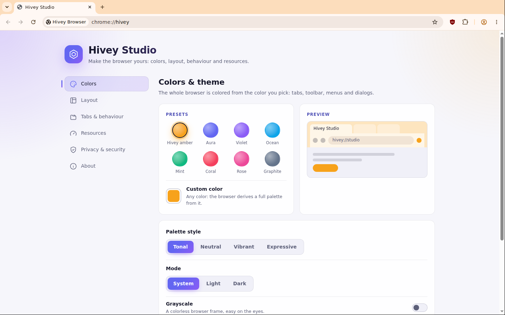
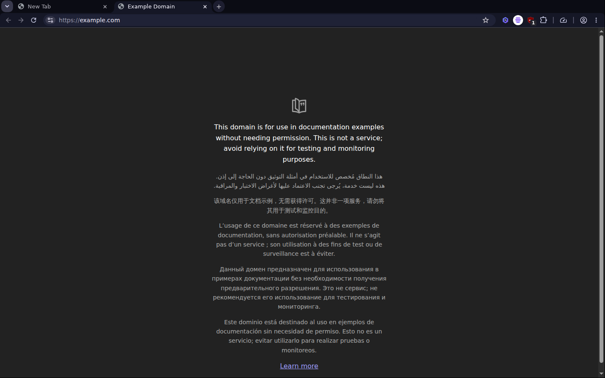
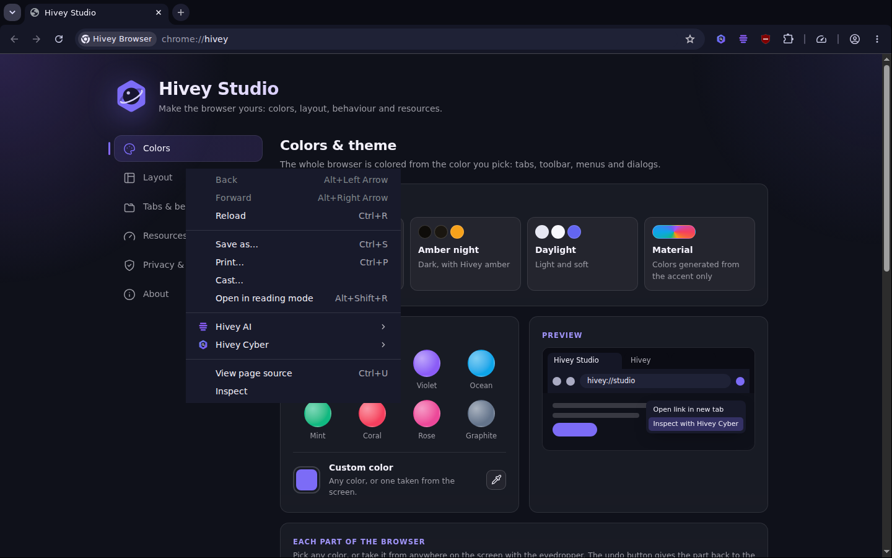
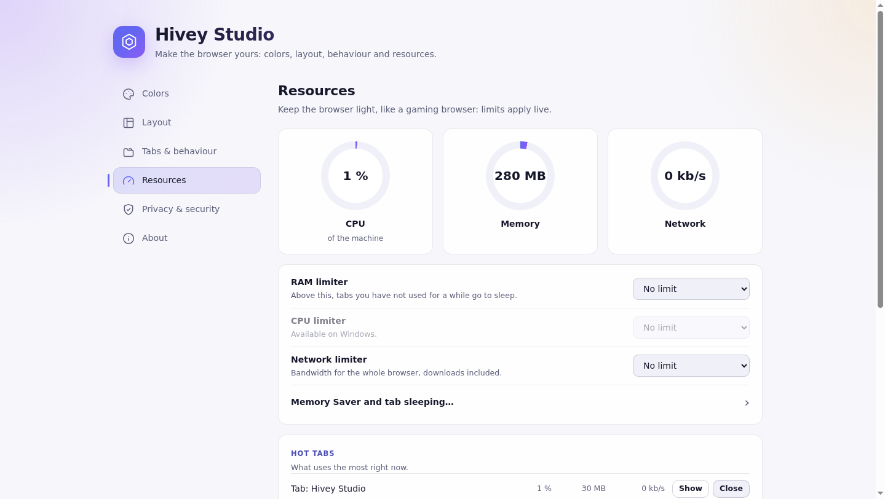

# User guide

## Install

- **Windows x64**: run [hivey-browser-windows-x64-installer.exe](https://github.com/FlorianMartins/hivey-browser/releases/latest/download/hivey-browser-windows-x64-installer.exe)
  (always the latest version).
  It installs for your user only (no administrator rights) and keeps its data
  in `%LOCALAPPDATA%\Hivey\Browser\User Data`, separate from Chrome or
  Chromium.
- **Linux x64**: extract [hivey-browser-linux-x64.tar.xz](https://github.com/FlorianMartins/hivey-browser/releases/latest/download/hivey-browser-linux-x64.tar.xz) anywhere
  and run `hivey-browser`. `hivey-browser.desktop` and `hivey-browser.png`
  are there for your menu.

The first window opens **Hivey Settings**, where everything below can be
changed. Open it later from the menu (⋮ > *Hivey Settings*) or at
`chrome://hivey`.

## Updates

Hivey Browser keeps itself up to date. It checks for a new version 10
minutes after it starts and then twice a day; on Windows it installs it in
the background and the menu shows *Relaunch to update*. On Linux, Hivey
Settings > About shows the new version with a download link. Updates are
signed: the browser refuses anything else. *Hivey Settings > About* shows the
status, checks on demand, and turns automatic updates off.

## Privacy, out of the box

- **Hivey Shield** (uBlock Origin Lite, the shield icon in the toolbar)
  blocks ads, trackers, cookie banners, tracking parameters in links and
  malware sites, and hides the empty boxes ads leave. The number on the icon
  counts what it blocked on the page. Click it to relax or tighten filtering
  for a site.
- **Third-party cookies blocked**, **secure connections only** (a warning
  before any plain-HTTP page), **encrypted DNS** through Quad9, **Global
  Privacy Control**, and **Google** for searches (Hivey Settings > Layout
  changes it: DuckDuckGo, Brave, Startpage...).
- **Fingerprinting protection.** Sites cannot recognize your computer from
  how it draws, measures text, plays audio, which fonts it has or which GPU it
  uses. If a site that draws or processes sound misbehaves, turn
  *Anti-fingerprinting* off in Hivey Settings > Privacy and restart.
- **Referrers** sent to other sites only say which site you came from, never
  the page.
- **No Google services, no telemetry, no crash reports**, and no request at
  startup.
- **Devices** (USB, serial, HID, Bluetooth) are off limits to sites. If you
  use a site that programs a board or talks to a security key over HID,
  allow it from the address bar or turn the protection off in Hivey Settings >
  Privacy. *Hardened mode* (same place) turns the JavaScript optimizer off
  everywhere: slower pages, much less to attack.

## The Hivey bar

A column at the edge of the window gathers Hivey's tools: in the middle, the
workspaces of **Hivey Tools** (chat, web chats, agent, MCP, translation, text
improvement, images, PDF, security, Wisebase, benchmark), which open the
side panel on that workspace (click again to close it; the mouse wheel moves
between workspaces while it is open); at the bottom, **Hivey Cyber**,
**Performance**, **History**, **Bookmarks** and **Settings**. It sits on the right, or on the left with vertical tabs.
Right-click it to move it or hide it; right-click the tab strip (or use Hivey
Settings > Layout) to show it again. The same tab strip menu puts vertical tabs
on the left or the right.

Everything is set from the bar itself: **drag a button** to move it (a line
shows where it lands); **right-click** to hide a button, show hidden ones
again, pick the **icons** (modern full-color images, or classic line icons,
multicolor or in the theme's color; colors are kept for Hivey Tools'
workspaces), move the bar or hide it. **Back, Forward and Reload** sit at its
top, out of the toolbar; **Settings** closes its tab when it is the current
one. Hivey Settings > Layout > **Hivey bar** has the same choices, plus **your
own sites**: each gets a button with its initial and opens in the side panel,
signed in like in a tab; links to other windows open in tabs. Without the bar,
Hivey Tools is the full extension again (its own tabs menu and side).

## Server info

The chip at the right end of the address bar shows the country of the site's
server (flag and code; the code only on Windows). Click it for the IP address,
the country and the connection, WHOIS or IP details links, **Analyze with
Hivey Cyber** (its security tools for the site) and **Translate this page**
(Hivey Tools' translation, in the side panel). The lookup uses a database
shipped with the browser: nothing is sent anywhere.

## Hivey AI

The Hivey AI icon in the toolbar opens the **Hivey AI sidebar**. Add your API
key (or a local model) in its settings; it then answers about the page you
are on, summarizes, translates or writes. It reads a page only when you open
it on that tab: other pages cannot reach it. See [PRIVACY.md](PRIVACY.md#the-hivey-ai-sidebar).

## Security tools

The **Hivey Cyber** icon (shield and magnifier) checks the current site:
WHOIS, IP geolocation, DNS, certificates, VirusTotal, urlscan.io, Shodan, SSL
Labs, security headers, Observatory and the Wayback Machine. Right-click a
link or a selection for the same tools, or to look selected text up in
VirusTotal or Have I Been Pwned.

## Hivey Settings

| Section | What you can do |
| --- | --- |
| Colors | A **theme** (Aura, Midnight, Ocean, Forest, Rose, Amber night, Daylight, or Material, whose card opens a color picker for its seed color), then **a color for every part of the browser**: window frame, toolbar, tabs, address bar, icons, accent, menus, panels, pages. The **eyedropper** picks a color anywhere on the screen, also outside the browser. The window icon and the taskbar or dock icon take the accent color. Choosing a theme replaces your own colors. Also: palette style, light/dark/system mode, grayscale, Incognito windows. |
| Layout | The **Hivey bar** (shown or hidden, left, right or automatic), **vertical tabs** on the left or right (they can expand on hover, off by default), **compact mode** (a lower toolbar and tab strip), side panel left or right, Home and Forward buttons, bookmarks bar, tab search button, profile button, extensions menu, toolbar buttons, a **custom new tab page**, fonts and default zoom. |
| Tabs & behaviour | Ctrl+Tab in recently-used order, the mouse wheel over the tab strip, keep the window open when closing its last tab, hide tab close buttons, pop-ups as tabs, tab previews, ask before closing. |
| Resources | Live CPU, memory and network gauges; the **hot tabs** (show or close them); the **RAM limiter** (background tabs go to sleep above the limit), the **CPU limiter** (Windows: a hard cap per tab) and the **network limiter** (bandwidth for the whole browser, downloads included). |
| Privacy & security | Hivey Shield and Hivey AI status, anti-fingerprinting, secure connections, clear data on exit, device blocking, hardened mode, secure DNS and cookie settings. |
| About | Version and automatic updates. |

Options marked ↻ apply after a restart; Hivey Settings offers a *Restart*
button when one is pending. Hivey Settings follows changes made elsewhere (a
right-click on the tab strip, Settings) as they happen.

The **Resources** button (gauge icon) in the toolbar opens the live gauges,
the hot tabs and the limiters in a dropdown, like an extension's popup.

## Memory and performance

- **Memory Saver** is on: tabs you have not used for a while are put to
  sleep and reload when you come back. *Settings > Performance* sets how
  aggressive it is and which sites always stay awake.
- The **RAM limiter** is a soft limit: it checks every 30 seconds and puts
  the least recently used background tabs to sleep until the browser is back
  under the limit. Tabs playing audio or with a form being filled are kept.
  Measured on Windows with a 1 GB limit and 12 news sites open: 1.23 GB, then
  1.01 GB.

## Advanced switches

`chrome://flags` lists every Hivey Browser and ungoogled-chromium option
(search for "Hivey" or "ungoogled"); Hivey Settings shows the useful ones.
